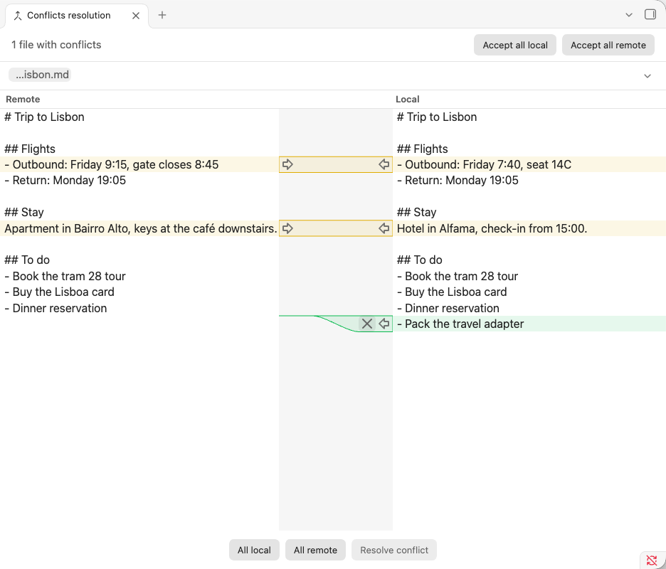
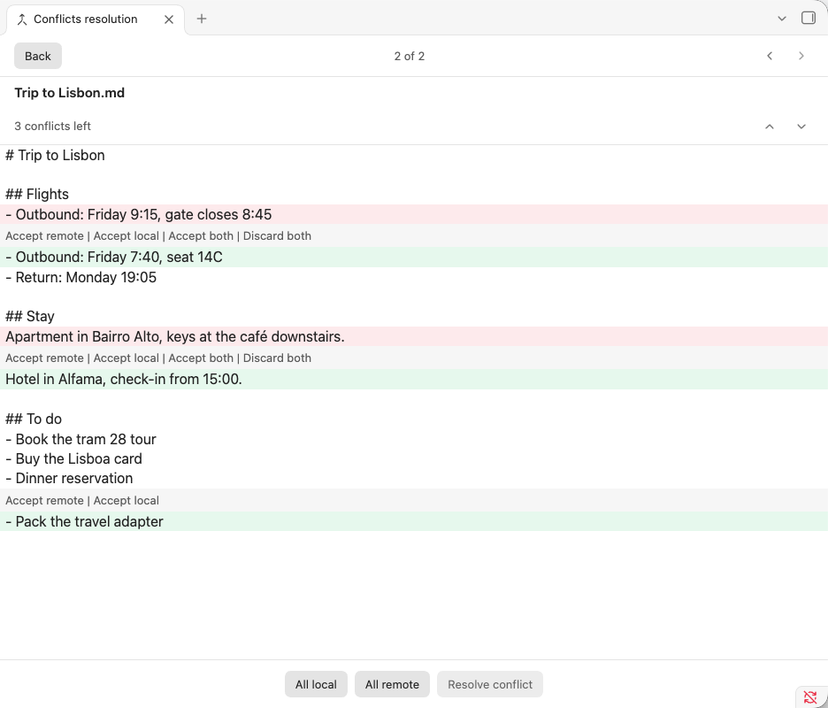

# GitHub Gitless Sync

Plugin to sync a GitHub repository with an Obsidian vault.

> [!NOTE]
> This is a fork of [GitHub Gitless Sync](https://github.com/silvanocerza/github-gitless-sync) by
> [Silvano Cerza](https://silvanocerza.com), maintained by David Sevcik and modified since November 2026.
> It's not the version you find in the Obsidian community plugins, see [what's different](#changes-from-the-original-plugin).
> If you have a problem with this fork don't report it to the original project, open an issue [here](https://github.com/davidsevcik/github-gitless-sync/issues).

I highly recommend not using this plugin with another sync service.
This might create problems for this plugin when determining what needs to be synced between remote repository and local vault.

## Features

These are the main features of the plugin:

- Desktop and mobile support
- Doesn't require `git`
- Multiple vaults sync
- Automatic sync on fixed interval
- Manual sync
- Conflict resolution view
- Sync of configs, plugins and other hidden folders
- Excluding files with a `.gitignore`

## Installation

This fork is not available as a community plugin, searching for it in Obsidian installs the original plugin.

The easiest way to install it, and to keep it updated, is with [BRAT](https://github.com/TfTHacker/obsidian42-brat):

1. Install the BRAT community plugin and enable it
2. Run the `BRAT: Add a beta plugin for testing` command
3. Enter `davidsevcik/github-gitless-sync`

You can also install it manually by downloading `main.js`, `manifest.json` and `styles.css` from the
[latest release](https://github.com/davidsevcik/github-gitless-sync/releases/latest) and copying them to
the `.obsidian/plugins/github-gitless-sync` folder of your vault.

> [!WARNING]
> This fork has the same plugin ID as the original one, so you can't have both installed in the same vault.
> If the original plugin releases a newer version Obsidian might offer to update to it, don't do that
> or it will replace this fork.

### Issues

If you find any problem please open an [issue](https://github.com/davidsevcik/github-gitless-sync/issues) with as many details as possible.

Please also provide logs if possible, you can copy them from the settings page. Remember to enable logging first.


## Usage

### First sync

> [!IMPORTANT]
> The first sync will only work if either the remote repository or the local vault are completely **EMPTY**. If both contain files the first sync will fail.

You must also configure the plugin settings before syncing.

These settings are mandatory:

- Your GitHub Token (see below)
- Repository owner
- Repository name
- Repository branch

If any of this is not set sync won't start.

### Token

A GitHub Fine-grained token is required to sync with your repository. You can create one by clicking [here](https://github.com/settings/personal-access-tokens/new).
The token must have the `Contents` permission set to `Read and write` like in the screenshot below.


I also suggest creating the token with access only to your sync repo.

### Sync modes

You can always sync manually by clicking the sync button in the side ribbon.
This will always work even if sync on interval is enabled.


If you don't want to see the button you can hide it, just check the plugin settings.

The `Sync with GitHub` command is also available.

### Conflict resolution

When you sync multiple vaults using this plugin you might risk creating conflicts between the remote and a local vault.
This usually happens when the remote has a new update from vault A, but vault B edits the file before syncing with remote.
That creates a conflict, by default we'll open a view to let you resolve the conflict since you should have all the necessary
information to correctly resolve it.

By default the split view will be used on desktop and the unified one on mobile, you can change the settings to always use the one you prefer.




Files that aren't text, like images or PDFs, can't be merged: you keep either the local or the remote version, which replaces the other one.

If you don't want to resolve them you can change the settings to always prefer either the remote or local version in case of conflicts.

### Config sync

If you want to sync your vault configs with other vault you can enable that.
It will sync the whole folder, that is `.obsidian` by default, including all plugins and themes.

Note that the `.obsidian` folder will always be present, this happens because the plugin
needs to store some metadata to correctly sync

To set up a new device from a repository that already contains configs: create an empty vault,
install and configure this plugin, enable config sync, then sync. The remote configs overwrite the
local ones, apart from the workspace files and this plugin's own settings. Restart Obsidian
afterwards to apply them.

Files added or removed in the config folder, like when you install or uninstall a plugin, are found
when syncing. The same goes for any other hidden folder in your vault, those are always synced.
`.git` and `.trash` folders are never synced, and neither are hidden files.

The settings of this plugin are never synced, as they contain your GitHub token, so you must
configure it on each device. If they were synced by an older version they're deleted from the remote
repository at the next sync, though they're still in its history. If your repository is public, or
has ever been, create a new token and delete the old one.

### Sync commits

Each sync that changes something creates a commit in your repository. Its message tells which files
have been added, updated and deleted, and the device that did it.

By default the device is identified by its platform, like `macOS` or `iOS`. You can set a different
name for each device in the settings.

### Ignoring files

If you want to exclude some files from syncing, create a `.gitignore` file in the root of your vault.
It uses the same syntax git uses, for example:

```gitignore
# Logs and temporary files
*.log
*.tmp
.obsidian/plugins/*/cache/
```

Ignored files are never uploaded, downloaded or deleted by the plugin.
The `.gitignore` file itself is synced like any other file, so the same rules apply on all your devices.

Only the `.gitignore` in the vault root is read, those in other folders are not.
If a file was already synced before you ignored it, it stays in the remote repository until you delete it from there.

### Reset

If you need to reset the plugin settings and metadata you can easily do that in the settings.

That will completely wipe all the sync metadata so you'll have to repeat the first sync as if you just enabled the plugin for the first time.

## Changes from the original plugin

This fork started from version 1.0.7 of the original plugin. These are the differences:

- The first sync downloads the configs of the remote repository in a new vault, if config sync is enabled
- Files added or removed in the config folder, and in any other hidden folder, are synced. For example when installing or uninstalling a plugin
- Files added or removed while Obsidian is closed, or by other apps, are synced too
- Conflict handling set to overwrite the local or the remote file does so. In the original plugin both settings uploaded the local file
- An edit made after a sync downloaded the file is never mistaken for the download, so a deletion on another device can't win over it
- Files can be excluded from syncing with a `.gitignore`
- The settings of this plugin, that contain the GitHub token, are never synced
- Deleted files are deleted from the other devices too, and are tracked for 30 days instead of forever
- A sync can't revert the changes of the previous one, or overwrite changes made to the remote repository while syncing
- Sync commits and notifications tell which files changed, and commits tell the device too
- Changes committed to the remote repository outside of the plugin, with git, on the GitHub website or by GitHub Actions, are synced too

## FAQs

### What's different from other sync plugins?

There are obviously other plugins that let you sync your vault with GitHub or other git hosts, like [`obsidian-git`](https://github.com/Vinzent03/obsidian-git) and [`Obsidian-GitHub-Sync`](https://github.com/kevinmkchin/Obsidian-GitHub-Sync) just to name a couple.

Most of those plugins though require the `git` executable to be present in your system, they might rely on Bash scripts too. This makes them much less portable, it's harder to use on Windows, and mobile is really unstable because most of the times they rely on [`isomorphic-git`](https://isomorphic-git.org/).

This annoyed me because I wanted to have the same experience on every platform, and I wanted especially to support mobile.

So I went a different way and chose to sync **only** with GitHub using their REST APIs, this means I don't rely in anyway on `git` being present in your system. This way I can easily support desktop and mobile with the same identical logic, and some small necessary differences in the UI for a better user experience.

This obviously comes with some limitations. Since `git` is not used you can't interact with your repository locally in any way, and any `git` feature like branching, merging, or rebasing, are not available at all.

Also since this relies only on the GitHub APIs you can only sync with GitHub and no other host.

### Can I use this with other sync plugins?

No.

To work correctly this plugin uses a custom metadata file that is updated every time we sync. Other plugins don't know about that file, so if you sync with others too you risk losing data.

You can still commit to the repository outside of Obsidian, with git, on the GitHub website or with GitHub Actions. The plugin finds those changes by comparing the files in the repository with its metadata file. If a file changed there has also changed in the vault you're asked to solve the conflict, and if it has been deleted there but edited in the vault it's kept and uploaded again.

## Contributing

Contributions are obviously accepted.

Bug fixes are always welcome, new feature must be discussed first. Open an [issue](https://github.com/davidsevcik/github-gitless-sync/issues) and let's talk in that case.

If your change makes sense for the original plugin too, consider contributing it [there](https://github.com/silvanocerza/github-gitless-sync).

Keep PRs as small as possible.

## License

The project is licensed under the [AGPLv3](https://www.gnu.org/licenses/agpl-3.0.en.html) license.

The original plugin is the work of [Silvano Cerza](https://silvanocerza.com), this fork is distributed under the same license.
